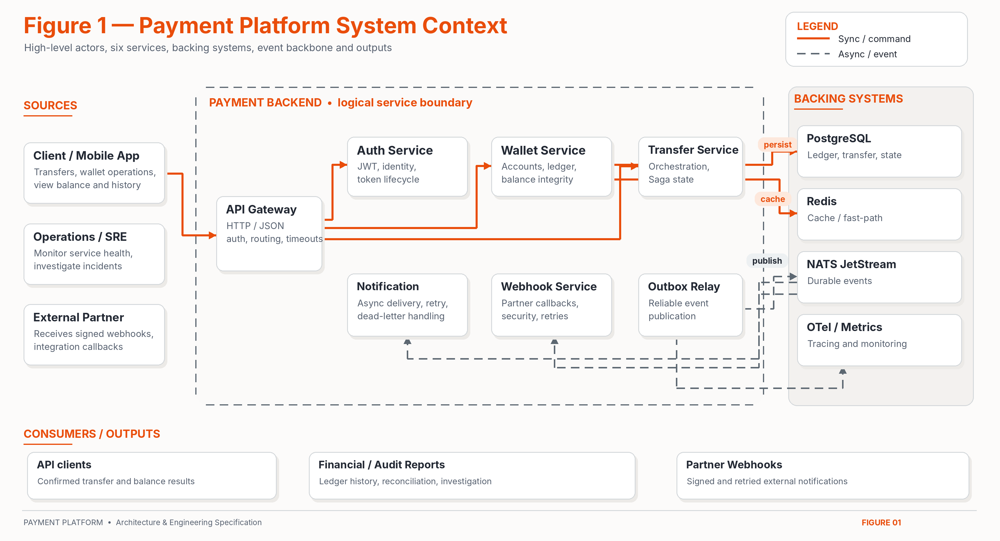
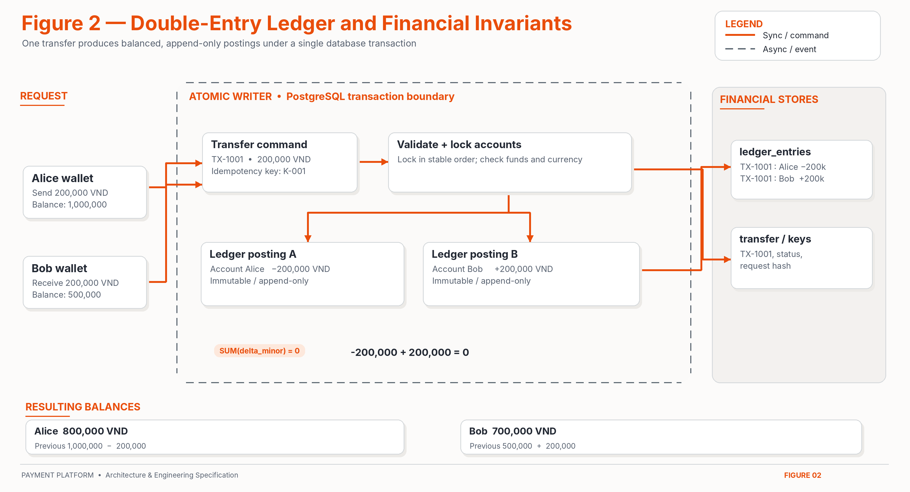
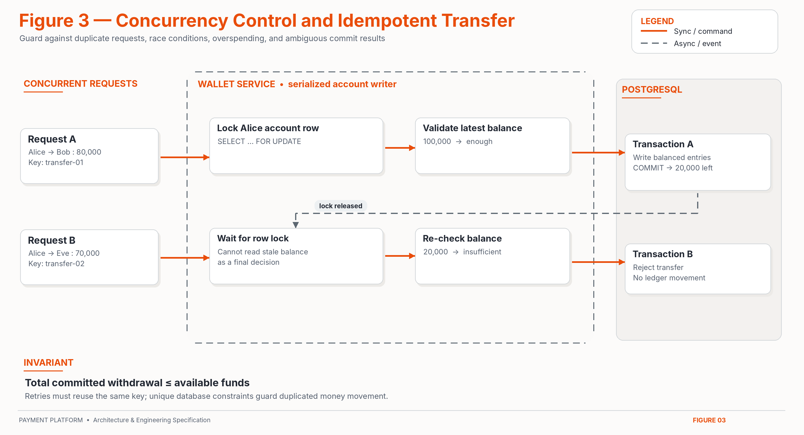
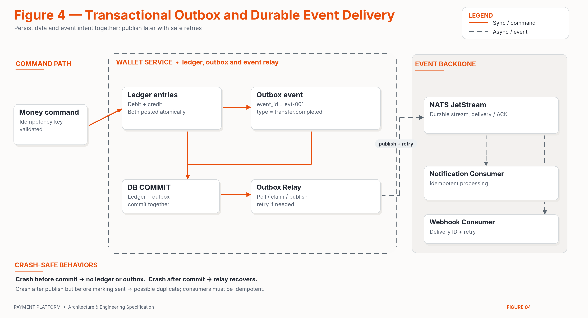
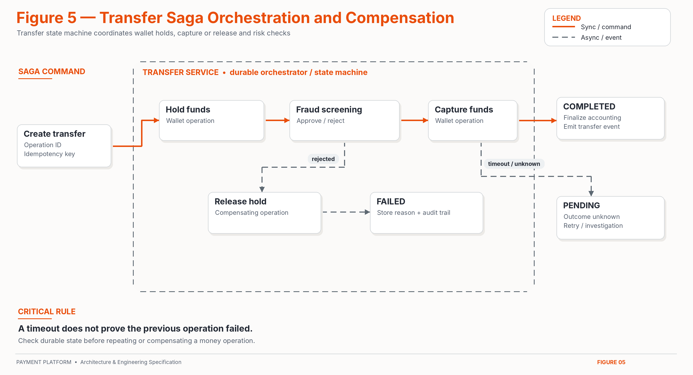
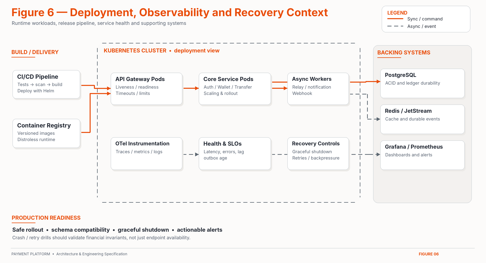

# Payment Platform — Architecture & Engineering Specification

**Scope:** Go microservices backend  
**Status:** Architecture baseline for repository documentation  
**Last reviewed:** 2026-11-22  
**Canonical implementation:** [`dev-marker/payments`](https://github.com/dev-marker/payments)

> **Engineering scope.** This document describes the platform boundaries, core invariants, logical flows and operational contracts of the reference implementation. The source code, database migrations, API contracts and executable tests remain the source of truth for exact implementation details. The project is a technical reference and is **not certified for production movement of real money**.

## 1. Purpose and architectural principles

The Payment Platform is a Go-based backend for accounts, wallet operations, transfers, authentication, event-driven notifications, outbound webhooks, financial reporting and operational observability. Six Go services share one Go module but are deployed as separate service processes; each service owns its PostgreSQL database. Communication uses HTTP, gRPC and NATS JetStream according to the interaction. The repository includes Docker Compose, Kubernetes/Helm deployment materials, CI and integration/load testing.

The architecture is built around five non-negotiable properties:

1. **Financial correctness:** represent money as `int64` minor units, preserve double-entry balance invariants per currency, and retain an auditable ledger.
2. **Atomic local writes:** related postings and application state must be committed or rolled back together within one PostgreSQL transaction.
3. **Retry safety:** money-moving requests require idempotency; network retries must not duplicate a logical operation.
4. **Reliable events:** persist event intent with business changes using a transactional outbox; deliver events asynchronously through NATS JetStream.
5. **Recoverable workflows:** cross-service transfers require durable states, bounded retries and explicit compensation where appropriate.

**Architecture boundary:** database transactions provide local atomicity. NATS delivery, external webhooks and multi-service workflows are asynchronous; they do not share a global ACID transaction.

## 2. System context and service ownership

{width=8.9in}

*Figure 1. Logical context and service responsibilities. The backing-system box represents platform dependencies, not a claim that they must be off-cluster or share a single deployment topology.*

| Service | Default port | Responsibility |
|---|---|---|
| **gateway** | `8080` (internal `9080`) | Public ingress, JWT checks, rate limiting and routing. |
| **wallet** | `8081`; gRPC `9081` | Accounts, double-entry ledger, balance operations, holds, idempotency and FX conversion. |
| **auth** | `8082` | Users, Argon2id password hashing, EdDSA access JWTs and rotating refresh tokens. |
| **transfer** | `8083` | Durable transfer orchestration using Saga, hold/capture/release, retries and compensation. |
| **notification** | `8084` | Event-triggered email processing, idempotent consumption, retry/backoff and dead-letter handling. |
| **webhook** | `8085` | Signed outbound deliveries, delivery records, retry and replay. |

**Service ownership:** the Wallet Service is responsible for ledger correctness. The Transfer Service coordinates workflows; it does not replace Wallet's financial transaction boundary. Notification and Webhook act on committed events and must not determine whether money was successfully posted.

### 2.1 Synchronous command path

A client sends HTTP requests through Gateway. Gateway enforces edge controls and routes to relevant services. Internal wallet operations can use the typed gRPC contract under `proto/wallet/v1/`, with generated Go code under `gen/wallet/v1/`. A timeout from an upstream call does not prove that a downstream operation rolled back; callers must use operation identifiers and idempotent retry semantics.

### 2.2 Asynchronous event path

Wallet or other event-producing components record an outbox entry with the committed business change. An outbox relay publishes to NATS JetStream. Notification and Webhook consumers process their subscriptions independently. The publication and consumption paths are at-least-once in practice: duplicate messages are possible and consumers need deduplication or otherwise idempotent effects.

### 2.3 Backing infrastructure

| Dependency | Role |
|---|---|
| PostgreSQL 17 | Durable service-owned data, ACID transactions and ledger state. |
| Redis | Cache/fast path, rate limiting and selected risk-related counters. |
| NATS JetStream | Persisted event streams, acknowledgement and redelivery. |
| Mailpit | Local email capture and inspection. |
| Jaeger | Distributed traces. |
| Prometheus / Grafana | Metrics and dashboards. |

## 3. Financial model and ledger invariants

Money is represented using integer minor units rather than floating-point types. The Wallet Service maintains an append-only double-entry ledger; balances are derived from the postings. Each posted operation must preserve zero-sum accounting within the relevant currency.

{width=8.9in}

*Figure 2. A signed-postings illustration of a single-currency transfer. The signed-delta convention is a simplified representation; formal debit/credit semantics depend on account type.*

### 3.1 Required invariants

- **Balanced postings:** for every committed journal transaction and currency, the sum of signed posting amounts equals zero.
- **Atomic posting:** all postings related to one local financial operation commit together or all roll back.
- **Stable history:** posted ledger entries are preserved for audit. Corrections use reversal/adjustment entries rather than silently rewriting historical postings.
- **No unintended overdraft:** balance validation and concurrency protection must respect the product's available-funds rules.
- **Idempotent movements:** repeated submission of the same logical command must not result in an additional money movement.
- **Currency integrity:** never sum different currencies as if they were one unit; FX requires explicit conversion and rounding rules.

Zero-sum alone does not prove business correctness. A duplicated transaction can still be perfectly balanced. Similarly, replayed events must not create a second transfer or external side effect.

### 3.2 Data model and schema authority

Database schema and migrations are maintained under `db/`. SQL query generation is configured by `sqlc.yaml`; the Go code uses sqlc and pgx. **Do not copy demonstration DDL into production migrations.** Consult the actual migration files to determine table names, columns, unique indexes, row-lock targets, currency constraints and the enforcement location of accounting invariants. This specification intentionally does not invent those details.

### 3.3 Balance reads and performance

Ledger-derived balances provide traceability. Repeated aggregation across a growing ledger can increase read cost; performance changes must preserve ledger correctness and be supported by measured queries, explain plans and invariant tests. Any cached or materialized balance is an optimization, not permission to bypass posting rules.

## 4. Concurrency control and idempotency

The Wallet Service uses PostgreSQL row locking, deterministic lock ordering and retry handling for concurrent money movement. Every financial writer must honor the same serialization contract; locking one account row does not automatically prevent unrelated writers from inserting ledger entries through another path.

{width=8.9in}

*Figure 3. Competing withdrawals from one account: the second operation must observe committed funds after the first operation completes.*

### 4.1 Operational rules

1. Claim or resolve the idempotency key and compare request identity.
2. Begin a database transaction using the isolation and locking protocol defined by the Wallet implementation.
3. Acquire conflicting account locks in deterministic order to reduce deadlock risk.
4. Validate available funds against the state appropriate to that transaction.
5. Record financial postings and related state changes; commit as one unit.
6. Persist or retrieve an operation result so that a duplicate request returns the existing outcome.
7. Retry recognized transient failures with a finite budget and jitter. Do not blindly retry all application errors.

Redis can accelerate idempotency lookups, but cache eviction or outage must not erase the durable record of a completed money movement. The database-level uniqueness and operation-state behavior must be verified in the implementation and tests.

### 4.2 Failure and recovery contract

| Failure case | Required safe behavior |
|---|---|
| Process crashes before commit | No partially committed financial operation. |
| Commit succeeds but HTTP/gRPC response is lost | Retry with same operation identity yields no second money movement. |
| Two requests reuse one key concurrently | Only one logical operation is accepted for the matching request. |
| Different requests compete for insufficient funds | No overspending after serialization. |
| Transaction is aborted because of a deadlock or serialization failure | Retry the whole operation as appropriate; never commit a partial state. |

## 5. API, authentication and service communication

Gateway is the public entry point. Auth Service manages identity using Argon2id credentials, EdDSA access JWTs and refresh token rotation. Gateway handles JWT verification, rate limits, CORS and timeouts. Internal wallet APIs use gRPC with protobuf contracts and deadlines; HTTP and gRPC errors need a consistent domain-to-transport mapping.

The authoritative API interface is the repository's `api/` request collection and the protocol definitions under `proto/`. Exact routes, request payloads, auth scopes and gRPC method signatures must be read from these files, not reconstructed from diagrams.

**Security principles:** validate identity at trusted boundaries; limit privileges between services and databases; keep secrets out of Git; use mTLS for protected inter-service connections where configured; treat external webhook destinations as untrusted input and defend against SSRF.

## 6. Transactional outbox and NATS JetStream

Posting a ledger transaction and publishing an event are separate operations. If a process crashes after the PostgreSQL commit but before broker publication, publishing directly from application code can lose the event. The transactional outbox persists the event intent in the same local database transaction as the business state; the relay publishes it later.

{width=8.9in}

*Figure 4. Ledger and outbox commit together; broker publishing and consumer execution are independent, retryable stages.*

### 6.1 Outbox delivery contract

- Business state and the event-to-publish are inserted in one database transaction.
- Relay identifies pending records, publishes to the appropriate NATS subject or stream and records progress.
- JetStream persists messages and supports acknowledgement/redelivery according to consumer configuration.
- If relay crashes after publish but before recording completion, the same event may be published again.
- Consumers must prevent duplicate business effects; acknowledgement follows safe processing.
- Backlog, oldest pending event age, failed publishes and consumer redelivery must be observable.

**Important guarantee:** the outbox pattern does not make a PostgreSQL commit and broker publication one distributed ACID transaction. Its reliability depends on durable outbox storage, relay recovery and idempotent consumers.

### 6.2 Notification and webhook consumers

Notification Service handles event-driven emails with backoff retries and a dead-letter queue. Webhook Service signs deliveries, persists delivery attempts and supports retry/replay. A message that has been handled but not acknowledged may be redelivered. External effects, especially email and HTTP callbacks, require a separate delivery/operation identity where feasible.

## 7. Transfer Saga and compensation

The Transfer Service coordinates a durable transfer workflow across service boundaries. The wallet remains responsible for the hold, capture or release operations. Risk checks can influence whether a transfer proceeds automatically or requires review. Compensation is expressed through explicit financial operations, not through an imaginary rollback across independently committed databases.

{width=8.9in}

*Figure 5. Logical orchestration view for wallet holds, risk decisions and capture/release. Exact workflow states, transitions and retries are defined in Transfer Service source and its tests.*

### 7.1 Recovery rules

- Persist a durable workflow identity and current transfer state.
- Make each retried wallet operation idempotent.
- Treat transport timeout as an **unknown outcome**, not proof of failure.
- Determine prior operation status before repeating or compensating it.
- Release held funds only when the workflow determines release is safe.
- Record failed and pending cases so that operators can investigate and recovery jobs can resume.

**Consistency model:** Wallet's financial postings use local ACID guarantees. A workflow involving multiple services may be eventually consistent while the orchestrator progresses through durable states.

## 8. FX, fraud, reconciliation and reporting

**FX conversion:** currency quotes can expire, decimal rates and rounding rules must be explicit, and the accounting postings must balance in each currency. The repository includes four-entry conversion postings and fees. A currency conversion must not be represented by incorrectly adding unlike monetary units.

**Fraud and risk:** Redis-backed velocity limits, rules and manual review are part of the platform. Risk screening must be integrated with the transfer workflow in a way that preserves transfer state and avoids duplicate captures.

**Reconciliation:** scheduled jobs with leader election compare ledger and related financial records. Reconciliation detects mismatches; it must not silently rewrite immutable history. The platform also provides CSV statements and trial-balance-style reporting.

## 9. Observability and platform operations

OpenTelemetry instruments HTTP, gRPC and asynchronous hops. Metrics are exposed for Prometheus and visualized in Grafana; Jaeger supports distributed trace analysis. A transfer may involve multiple synchronous calls and events, so correlation across service and event boundaries is important.

{width=8.9in}

*Figure 6. Deployment and operations view. Kubernetes and backing-system placement are environment-dependent; Docker Compose remains the local development topology.*

### 9.1 Operational signals

| Domain | What to observe |
|---|---|
| API | Request rate, p95/p99 latency, timeouts, authentication failures. |
| Wallet | Transaction errors, lock waits, deadlocks, posting invariants. |
| Outbox/NATS | Pending outbox age, failed publish attempts, consumer redelivery, dead letters. |
| Transfer Saga | Duration by state, retries, compensations, stalled workflows. |
| PostgreSQL | Pool saturation, slow queries, index efficiency, migration health. |
| Deployment | Readiness, graceful shutdown, rollout errors, pod restarts and resource saturation. |

**Metric-label discipline:** do not place arbitrary user IDs, transaction IDs or event IDs in Prometheus labels. Use controlled traces/logs and protected lookup tools for high-cardinality identifiers.

### 9.2 Delivery and runtime

The repository includes a multi-stage container build, distroless runtime images, health probes, graceful draining, GitHub Actions, Docker Compose and a Helm deployment for six services. Kubernetes examples include rolling updates and autoscaling. Database migrations and release processes need backward compatibility when several application revisions are running simultaneously.

## 10. Repository layout and development workflow

The following paths exist at the repository root. Subdirectories and exact function names are intentionally not asserted here unless checked from source.

| Path | Purpose |
|---|---|
| `cmd/` | Executable entry points. |
| `internal/` | Service and shared implementation packages. |
| `db/` | Database definitions and migration/query assets. |
| `api/` | HTTP request examples for exercising the system. |
| `proto/wallet/v1/` | Wallet protobuf API definitions. |
| `gen/wallet/v1/` | Generated wallet API Go code. |
| `deploy/` | Deployment configuration and Helm assets. |
| `.github/workflows/` | CI workflows. |
| `loadtest/` | Load-test assets. |
| `chaos/` | Fault-injection and recovery assets. |
| `sqlc.yaml`, `docker-compose.yml`, `Makefile` | SQL generation, local infrastructure and developer commands. |

### 10.1 Local startup

Prerequisites: Go 1.26, Docker, and `make`. Development-only keys should be generated locally and must not be committed.

```bash
make keys
# Starts infrastructure, migrations, and the six services
docker compose --profile app up -d --build --wait
```

After startup, exercise requests through `api/gateway.http` using an HTTP client. Local UIs are available at Mailpit `http://localhost:8025`, Jaeger `http://localhost:16686`, Prometheus `http://localhost:9090` and Grafana `http://localhost:3000` when the relevant Compose profile is running.

To work on one service: start dependencies with `docker compose up -d` and use the corresponding Makefile target such as `make run-wallet` or `make run-transfer`.

### 10.2 Test and verification commands

```bash
make test               # fast unit suite
make test-integration   # PostgreSQL/Redis/NATS integration suites
make test-race          # race detector
make loadtest           # k6 transfers; running app profile required
```

### 10.3 Required test scenarios

- Double-entry sum is zero for committed postings in the supported currency.
- Repeated concurrent calls with the same idempotency key do not move money twice.
- High-contention transfers cannot spend more than available funds.
- A crash after DB commit but before event publication does not lose the durable outbox event.
- Duplicate NATS delivery does not duplicate a downstream business effect.
- Saga workflows can recover or enter an explicit pending/manual-review state after partial failures.
- Graceful shutdown and rolling deployment do not invalidate financial invariants.

Passing these tests is evidence for the tested code and environment, not a substitute for independent financial/security assessment before real-money use.

## 11. Architectural decisions and trade-offs

| Decision | Benefit | Cost / constraint |
|---|---|---|
| Go services with explicit boundaries | Independently deployable domain responsibilities. | More network and operational complexity than a monolith. |
| PostgreSQL per service | Clear data ownership and local ACID boundaries. | Distributed workflows require coordination and eventual consistency. |
| Double-entry append-only ledger | Auditability and checkable financial invariants. | Balances and history queries need performance attention. |
| sqlc + pgx | SQL visibility with generated typed access. | Developers own SQL design, migrations and query tuning. |
| gRPC internally | Typed service contracts, deadlines and interceptors. | Protobuf lifecycle and operational tooling are required. |
| NATS JetStream + outbox | Recoverable async fan-out and decoupled consumers. | Relay, deduplication, lag monitoring and retries are necessary. |
| Saga orchestration | Explicit multi-step recovery and compensation. | More workflow state, edge cases and failure handling. |
| Redis fast paths | Lower latency for suitable reads/counters. | Durable correctness must not depend solely on cache state. |

## 12. Production-readiness boundary

The repository is a **technical reference implementation**. Do not describe it as regulator-approved or safe for handling live customer money without an explicit additional validation program. A production launch requires environment-specific security review, threat modeling, key lifecycle management, backup/restore tests, disaster recovery, reconciliation against external systems, incident runbooks, SLOs, monitoring alerts, data retention and operational ownership.

This document does not supersede the exact code or migration definitions. Any architectural change should update this specification and its figures in the same pull request, with tests demonstrating that financial invariants remain intact.

## 13. Source-of-truth references

- **Entrypoints and implementation:** `cmd/`, `internal/`
- **Database schema and queries:** `db/`, `sqlc.yaml`
- **API and protobuf contracts:** `api/`, `proto/wallet/v1/`
- **Deployment:** `docker-compose.yml`, `deploy/`, `.github/workflows/`
- **Tests and fault injection:** `loadtest/`, `chaos/`, Go test suites in the repository
- **Project license:** MIT (see `LICENSE`)

*Documentation maintenance rule:* source code and executable tests determine actual behavior; the architecture document records the intended boundaries, invariants, responsibilities and operational constraints.
