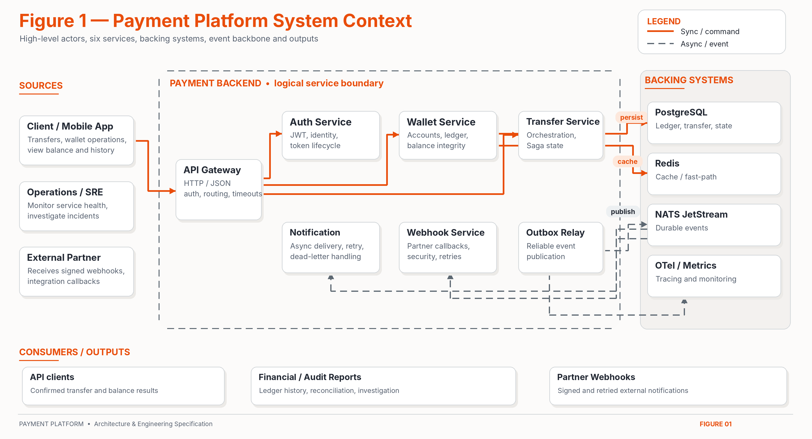
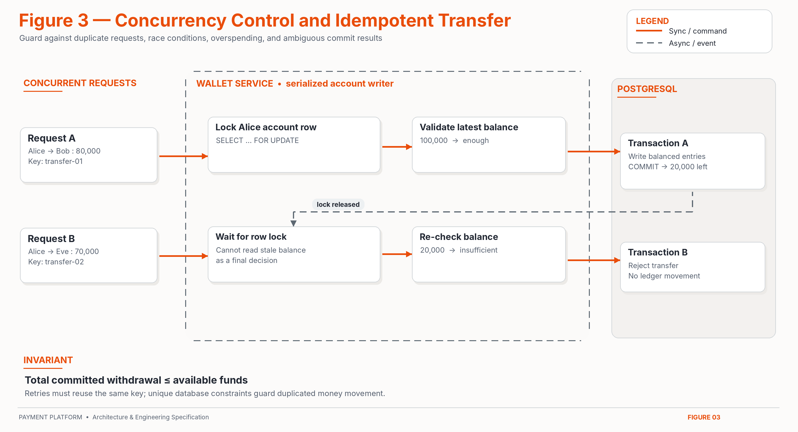
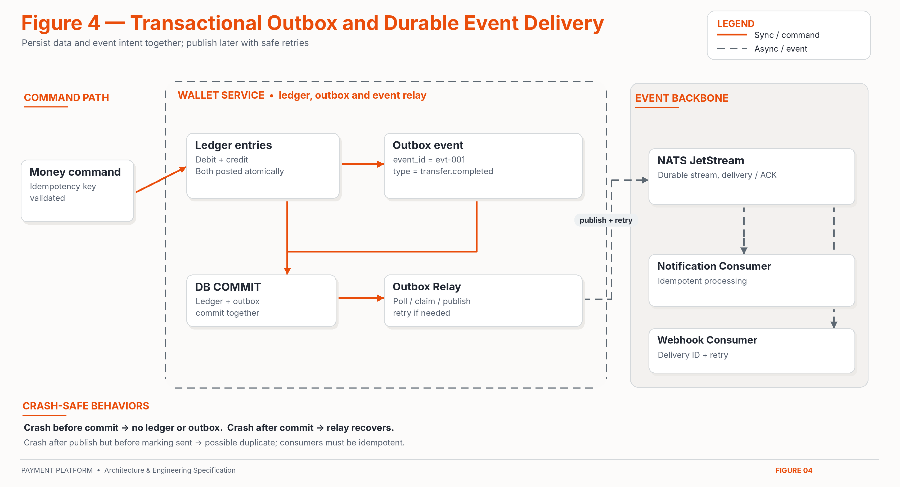
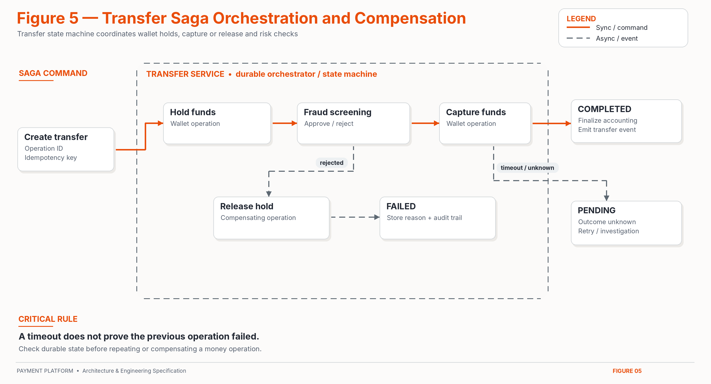

# Payment Platform — SOLID & Design Patterns Implementation Playbook

**Document type:** Hands-on engineering workbook  
**Companion:** [Architecture & Engineering Specification](architecture.md)  
**Scope:** Go, PostgreSQL, gRPC, NATS JetStream, six service boundaries  
**Status:** Proposed exercises and acceptance criteria; not an assertion that all suggested abstractions already exist

> **How to read this guide.** The repository README confirms the six services, double-entry ledger, idempotency, outbox/NATS, Saga, tests and toolchain. The **pattern mappings** below identify appropriate places to inspect or improve those capabilities. The **Go snippets are illustrative starter designs**, not copied code and not guaranteed to match existing symbols. Locate and inspect the real implementation before changing its architecture. Preserve money correctness over pattern purity.

## 1. Purpose and expected outcomes

The goal is to learn **when and why** a Design Pattern or SOLID principle improves real backend code—not to maximize the number of interfaces or packages. By finishing this playbook you should be able to identify responsibilities and invariants, place interfaces at the correct ownership boundary, isolate infrastructure without hiding SQL semantics, design retry-safe commands, run behavioral tests before and after refactors, and explain the cost of each abstraction in a pull request.

**Rules of engagement**

1. **Baseline first:** confirm existing behavior and record test results before refactoring.
2. **One reason per change:** implement one pattern or principle to solve one documented pain point.
3. **Preserve ledger invariants:** zero-sum postings by currency, atomic local writes, no unintended overdraft, and no double posting on retry.
4. **Boundaries before layering:** keep database transactions inside the component that owns them; do not turn a local ACID transfer into distributed calls merely to satisfy a diagram.
5. **Keep interfaces small:** in Go, define interfaces where they are *consumed* when useful, not automatically beside every struct.
6. **Prove it:** each lab finishes with a test, a failed-case check, and a short trade-off note.

### 1.1 Real project components and candidate techniques

| Domain / boundary | Behavior documented in repository | SOLID / pattern to examine | Exercise status |
|---|---|---|---|
| Wallet and ledger | Double-entry, funds movement, row locks | SRP, Repository, Unit of Work / transaction boundary | Inspect and optionally refactor |
| Wallet idempotency | Durable key with Redis fast path | DIP, command processing, invariant-focused tests | Inspect and extend |
| Transfer | Holds, capture/release, Saga | State, orchestration, ISP, DIP | Inspect and extend |
| Event publication | Transactional outbox to NATS JetStream | Outbox, relay, Adapter | Inspect and extend |
| Notification / webhook | Retry, idempotent consumer, DLQ / delivery log | Idempotent Consumer, Adapter, Decorator | Inspect and extend |
| Risk checks | Rules and velocity limits | Strategy / Chain of Responsibility (only if needed) | Proposed refactor |
| HTTP / gRPC boundaries | Validation, errors, deadlines, middleware | Adapter, DIP, Decorator | Proposed improvement |
| Reporting and operations | Reconciliation, metrics, tracing | CQRS-style read separation (only if justified), Decorator | Optional exercise |

**Not every row requires a new Go interface.** Prefer retaining code that is already simpler and sufficiently testable.

{width=6.8in}

*Figure 1. Service boundaries and dependencies. Keep financial transactions owned by Wallet; use the existing integration pathways rather than inventing new microservices for patterns.*

## 2. Engineering workflow: study → change → test → review

Run the existing platform first. These commands are published in the reference repository README:

```bash
make keys
docker compose --profile app up -d --build --wait
make test
make test-integration
make test-race
```

When working on a single Go service, start infrastructure with `docker compose up -d` and use the existing `make run-wallet` / `make run-transfer` commands if applicable. Keep generated keys, secrets and database credentials out of Git.

### 2.1 Locate the real extension point

The repository has top-level `cmd/`, `internal/`, `db/`, `proto/wallet/v1/`, `gen/wallet/v1/` and `api/`. **Do not assume deeper paths or exact Go identifiers** from this workbook. Use source navigation:

```bash
rg -n 'FOR UPDATE|SKIP LOCKED|outbox|idempotenc|jetstream|saga' internal db
rg -n 'interface\{|type .* interface|BeginTx|Commit\(' internal
rg -n 'Retry|Backoff|Hold|Release|Capture|Publish|Ack' internal
find internal -type f -name '*_test.go' | sort
```

Record what you find in a brief note before editing: current public behavior; callers; transaction boundaries; dependencies; tests; and one measurable problem. Avoid changing sqlc-generated or protobuf-generated code by hand; edit the schema/query/proto sources and regenerate where needed.

### 2.2 Every change follows the same checklist

- [ ] Identify the current behavior and why the existing design is insufficient.
- [ ] State the invariant that must remain true after the refactor.
- [ ] Write or identify a failing characterization / integration test.
- [ ] Implement the smallest change; do not rearrange unrelated packages.
- [ ] Add an error-path or concurrency test where applicable.
- [ ] Run the relevant unit, integration and race checks.
- [ ] Explain alternative designs and why the selected one is proportionate.

## 3. SOLID principles in idiomatic Go

| Principle | Apply it here | Good signal | Common misuse |
|---|---|---|---|
| **S — Single Responsibility** | HTTP parsing, financial decisions and SQL writes should be distinguishable responsibilities | A business rule can be tested without an HTTP server | One package/file/class per trivial action |
| **O — Open/Closed** | Risk rules, delivery transports, validation policies when variants genuinely grow | Add a new rule without editing a large conditional | Abstracting a single stable implementation prematurely |
| **L — Liskov Substitution** | Adapters and fakes must honor the behavioral contract of their interface | Equivalent observable guarantees across implementations | A fake that skips idempotency or lies about commit semantics |
| **I — Interface Segregation** | Saga workers need only the wallet capabilities they call | Small consumer-owned port | One giant `PaymentManager` interface |
| **D — Dependency Inversion** | Workflow logic depends on a narrow capability, not `*pgxpool.Pool` or `*nats.Conn` | Core tests run with a controlled fake | Interfaces defined for every struct with no substitution need |

**Go interpretation:** SOLID is guidance for coupling and responsibilities, not a mandate to replicate Java-style classes, service/repository interfaces and deep inheritance trees. Go favors composition, small interfaces, explicit dependencies and ordinary functions.

## 4. Lab 01 — Extract pure business rules (SRP)

**Goal:** separate transport input, financial validation, and persistence concerns. Start in Wallet's deposit/transfer command path, after locating the actual handler and service.

**Task:** identify one validation rule currently coupled to HTTP parsing or database access. Extract a pure function or value type without changing external endpoints. Keep domain validation and database-dependent validation separate.

```go
// Illustrative value type; adapt IDs and currency type to the project.
type TransferCommand struct {
    FromID      string
    ToID        string
    AmountMinor int64
    Currency    string
}

func (c TransferCommand) Validate() error {
    if c.FromID == "" || c.ToID == "" || c.FromID == c.ToID {
        return errors.New("invalid account pair")
    }
    if c.AmountMinor <= 0 || c.Currency == "" {
        return errors.New("invalid amount or currency")
    }
    return nil
}
```

**Test first:** table tests for zero/negative amount, same-account, missing account and valid command. Then prove handlers still return compatible status/error mappings. **Do not** move funds-available checks into this pure validation: availability is transaction-dependent.

**Done when:** rule is testable without DB or HTTP; no behavior change; errors retain the current public contract.

**Trade-off:** purity improves testability but cannot replace validation inside the locked transaction.

## 5. Lab 02 — Consumer-owned ports (DIP + ISP)

**Goal:** stop orchestration logic from depending directly on a concrete gRPC client without creating a large shared abstraction package.

**Task:** inspect how Transfer calls Wallet. If the orchestration code would benefit from substitution, introduce a narrow interface on the *consumer* side. Keep existing protobuf and network behavior inside an adapter. Use only operations actually needed by that component.

```go
// Example contracts, NOT verified names or signatures from the repo.
type FundsReserver interface {
    Hold(ctx context.Context, operationID, accountID string, amountMinor int64) error
}

type FundsReleaser interface {
    Release(ctx context.Context, operationID string) error
}

type TransferCoordinator struct {
    reserve FundsReserver
    release FundsReleaser
}
```

**Test first:** a fake that returns success, an explicit business rejection and a timeout/unknown outcome. Verify the coordinator does **not** treat timeout as proof that the remote operation failed. Be explicit about retry identifiers.

**Done when:** business orchestration tests do not require a live gRPC server; the adapter alone handles transport errors, deadlines and metadata.

**Trade-off:** a single concrete dependency can be simpler than an interface; introduce the port only when it provides a real test or substitution benefit.

## 6. Lab 03 — Persistence Adapter and transaction boundary (Repository + Unit of Work)

**Goal:** make the database boundary explicit without hiding the fact that money movement requires **one atomic transaction**.

**Task:** find a financial operation whose account locks, balance read, ledger postings and operation result must commit together. Verify that existing code does so. If refactoring, expose one cohesive domain operation rather than allowing callers to mix independently committed repository methods.

```go
// Conceptual boundary; persistence layer owns locks and commit.
type TransferWriter interface {
    ApplyTransfer(ctx context.Context, cmd TransferCommand) (TransferResult, error)
}

// Within the real PostgreSQL implementation (outline only):
// tx := pool.BeginTx(...)
// defer tx.Rollback(...)
// claim idempotency identity
// lock accounts in deterministic order
// validate available funds against locked state
// write balanced postings + operation result + outbox row
// tx.Commit(...)
```

**Acceptance tests:** a crash/error before commit leaves no partial postings; concurrent conflicting transfers cannot overspend; duplicate retries return the prior logical outcome. Prefer real PostgreSQL integration tests over an in-memory fake for lock/isolation correctness.

{width=6.8in}

*Figure 2. A service-level interface does not enforce financial correctness: the underlying PostgreSQL transaction and shared locking protocol do.*

**Trade-off:** a generic Unit-of-Work framework can obscure sqlc/pgx semantics. A narrowly scoped transactional method is often clearer.

## 7. Lab 04 — Replace growing conditionals with policies (OCP + Strategy)

**Goal:** model an *actual variability point*, such as adding independent fraud/risk checks, without modifying the whole transfer workflow for each new rule.

**Task:** inspect the risk checks already present. If introducing a new rule requires editing a long nested conditional, consider a small strategy interface or list of rules. If only one rule exists and will remain stable, prefer a function.

```go
// Proposed extension design, not a source-code transcription.
type RiskDecision struct {
    Allowed bool
    Reason  string
}

type RiskRule interface {
    Check(ctx context.Context, cmd TransferCommand) (RiskDecision, error)
}

type RiskEngine struct {
    rules []RiskRule
}

func (e RiskEngine) Check(ctx context.Context, cmd TransferCommand) (RiskDecision, error) {
    for _, rule := range e.rules {
        decision, err := rule.Check(ctx, cmd)
        if err != nil || !decision.Allowed {
            return decision, err
        }
    }
    return RiskDecision{Allowed: true}, nil
}
```

**Tests:** rule ordering; deny short-circuit; dependency failure (fail closed or pending-review as explicitly specified); deterministic behavior for same inputs. **Do not** accidentally accept risk checks when a network dependency fails.

**Trade-off:** a rule list trades direct clarity for extensibility. Policy order and error semantics become part of the contract.

## 8. Lab 05 — Model retry safety as a command contract (Idempotency)

**Goal:** protect logical financial commands, not merely HTTP request deduplication.

**Task:** trace a deposit or transfer from Gateway to the durable operation record. Document key scope (client/user + key), request fingerprint, unique constraint, conflict semantics, in-progress response and completed-result replay. Redis may accelerate the path but must not become the sole source of correctness.

**State-focused exercise:** deliberately submit the same key from two goroutines, then retry after a simulated response loss. Also reuse the same key with a different payload and assert an explicit conflict.

```text
New (principal, key, payload)  -> claim unique identity -> execute once
Same identity + same payload  -> return stored result/state
Same identity + new payload   -> reject identity conflict
Operation still pending       -> documented pending/retry behavior
```

**Tests:** concurrent duplicate requests; lost response after commit; key collision across principals; in-progress timeout; Redis unavailable; transaction failure before commit.

**Done when:** no retry or cache outage creates an extra balanced-but-duplicated money movement.

**Trade-off:** idempotency retention windows and request fingerprints are operational contracts, not mere implementation details.

## 9. Lab 06 — Reliable events across two systems (Transactional Outbox + Adapter)

**Goal:** preserve the one-db-transaction boundary while reliably publishing committed events to NATS JetStream.

**Task:** follow a domain mutation and outbox insert through the same transaction. Then trace how relay claims pending messages, publishes them and records progress. Do **not** publish directly from the business service as a replacement for the outbox.

{width=6.8in}

*Figure 3. DB commit and publish are separate boundaries. A relay crash after publish may cause duplicate delivery.*

**Suggested seams:** a narrow publisher adapter for NATS-specific calls; a repository function for claiming outbox work; business code coupled only to recording event intent as part of the financial transaction.

**Failure tests:** (1) DB commit succeeds while NATS is down; (2) relay crashes before publish; (3) relay publishes but crashes before marking done; (4) two relays run concurrently; (5) event is published twice but downstream business state changes once.

**Done when:** the outbox retains pending events during broker outage, replay is safe, and publishing never determines whether a ledger transaction commits.

**Trade-off:** outbox creates a backlog and an operator-visible delivery state; it provides eventual delivery with duplicates, not cross-system atomic exactly-once execution.

## 10. Lab 07 — Idempotent consumers and external delivery boundaries

**Goal:** consume NATS messages safely when JetStream redelivers or a process restarts.

**Task:** inspect Notification or Webhook event handlers. Make the processing identity explicit (`consumer` + `event_id` or equivalent). Coordinate durable deduplication with database effects, then acknowledge only after safe processing. For email/HTTP side effects, use a delivery record and partner/provider idempotency mechanism where available.

```text
Message received
   -> derive stable processing identity
   -> check/claim processing record
   -> perform durable local effect or manage delivery state
   -> commit progress
   -> ACK after safe completion
```

**Tests:** duplicate event; crash before ACK; crash after a provider accepted a request; poison message after bounded retries; dead-letter inspection; replay after consumer restart.

**Done when:** broker redelivery does not create an unintended duplicate *business* effect; any possible duplicate email/webhook delivery is understood and documented.

**Trade-off:** exactly-once delivery to arbitrary external systems cannot be promised just by storing a local deduplication row.

## 11. Lab 08 — Durable workflow transitions (State + Saga orchestration)

**Goal:** make Saga transitions, retry decisions and compensation easy to reason about and test independently from I/O.

**Task:** inspect the actual Transfer Service states and transition implementation. Draw the state graph from source/tests before proposing changes. If transitions are scattered across handlers and callbacks, consider a pure transition function that validates the allowed state/event pairs.

```go
// Illustrative model; actual project state names may differ.
type TransferState string
type TransferEvent string

const (
    StateCreated  TransferState = "CREATED"
    StateReserved TransferState = "RESERVED"
    StateDone     TransferState = "COMPLETED"
    EventReserved TransferEvent = "FUNDS_RESERVED"
    EventCaptured TransferEvent = "FUNDS_CAPTURED"
)

func Next(state TransferState, event TransferEvent) (TransferState, error) {
    switch {
    case state == StateCreated && event == EventReserved:
        return StateReserved, nil
    case state == StateReserved && event == EventCaptured:
        return StateDone, nil
    default:
        return state, errors.New("invalid saga transition")
    }
}
```

**Tests:** every valid transition; every invalid transition; duplicate event; remote timeout with unknown outcome; service restart mid-workflow; compensating release only when safe; repeated compensation idempotency.

{width=6.8in}

*Figure 4. A logical transfer workflow. The transition model must be derived from current source code, not imposed from this diagram.*

**Trade-off:** a general-purpose Saga framework might create more states and complexity than a few explicit, well-tested transition functions.

## 12. Lab 09 — Transport Adapters and error contracts (DIP)

**Goal:** retain business semantics while mapping HTTP/gRPC statuses and errors at the boundary.

**Task:** identify one domain error (insufficient funds, missing account, duplicate key, pending operation). Keep the domain error stable; put transport-specific mapping in the HTTP or gRPC adapter. Avoid returning raw PostgreSQL error strings to clients.

**Tests:** same domain error maps consistently to expected HTTP/gRPC status; internal details stay private; retries apply only to transient or explicitly retryable outcomes; upstream timeout does not erase the durable operation identity.

**Done when:** domain tests do not depend on transport status codes, and transport tests cover all documented error mappings.

**Trade-off:** a central `ErrorMapper` abstraction is useful only when it eliminates inconsistency; a small switch at one adapter can be simpler.

## 13. Lab 10 — Cross-cutting behavior with Decorator / Middleware

**Goal:** introduce tracing, metrics or timeout policy without contaminating business logic or multiplying wrapper layers.

**Task:** find an existing interface at an I/O edge (Wallet gRPC client, event publisher, delivery client). Wrap it with an observability decorator if the same behavior is repeated across multiple callers.

```go
// Proposed minimal decorator; instrumentation omitted intentionally.
type WalletOperations interface {
    Hold(ctx context.Context, operationID string) error
}

type ObservedWallet struct {
    next WalletOperations
}

func (w ObservedWallet) Hold(ctx context.Context, operationID string) error {
    // start span; record duration and error classification
    return w.next.Hold(ctx, operationID)
}
```

**Tests:** wrapper calls the dependency exactly once, preserves cancellation and errors, never logs secrets or full financial payloads; span context survives across HTTP/gRPC/NATS boundaries. Do not add automatic blind retries around non-idempotent operations.

**Done when:** observability behavior is composable and domain results are unchanged.

**Trade-off:** use standard middleware/interceptors already in the repo before inventing a new decorator framework.

## 14. Lab 11 — LSP and substitution contract tests

**Goal:** ensure mocks, fakes and production adapters fulfill the *same behavioral requirements* rather than merely sharing method signatures.

Write a shared contract test for a narrow capability. The test should run against a deterministic fake and, where relevant, a real PostgreSQL adapter. Check stable error categories, idempotent replay, cancellation handling and consistent state outcomes. A fake that always returns success is **not** evidence that concurrency or transactional behavior works.

**Review questions:** Could any caller tell the difference in behavior that matters? Does replacing a store violate atomicity? Does the fake model `unknown outcome` after timeout? Does every strategy honor the same ordering and failure semantics?

**Done when:** swapping a valid implementation never weakens the documented contract, and an integration test covers the guarantees that a fake cannot model.

## 15. Lab 12 — Architecture decision and measurable refactor

Complete one vertically sliced change with: a before/after dependency sketch; invariant list; minimal code diff; test evidence; and a brief architecture decision record (ADR). Do not add abstractions without a present use case.

**Pull request template**

```markdown
## Problem and change boundary
- Concrete problem:
- Existing module/operation:
- Why this pattern (and why not a simpler alternative):

## Preserved contracts
- Financial invariants:
- Public HTTP/gRPC/event contract:
- Transaction and retry boundary:

## Verification
- Unit tests:
- Integration tests (Postgres / NATS / Redis):
- Race / failure injection:
- Before vs. after performance (if relevant):

## Trade-offs and rollback
- Additional abstractions / operational costs:
- Rejected approach:
- Rollback plan:
```

## 16. Suggested execution plan

This is a **skill-building sequence**, not a claim that the original code needs every refactor. Each block fits roughly one focused working session; split any exercise that requires environment setup or longer integration debugging.

| Session | Focus | Evidence to commit |
|---|---|---|
| 1 | Baseline + discover real boundaries | Source notes, existing test results |
| 2 | SRP + pure validation | Table tests, unchanged API contract |
| 3 | DIP/ISP at Wallet client boundary | Fake-based orchestrator tests |
| 4 | Transactional repository boundary | PostgreSQL atomicity / concurrency tests |
| 5 | OCP strategy for a real rule variation | Ordered rule tests, rejection/failure semantics |
| 6 | Idempotency | Concurrent retries and response-loss tests |
| 7 | Outbox/NATS | Relay crash/replay integration tests |
| 8 | Idempotent consumer | Duplicate / redelivery / DLQ tests |
| 9 | Saga State | Transition table and compensation tests |
| 10 | Adapter + error mapping | Transport contract tests |
| 11 | Decorator + LSP | Observability and shared contract tests |
| 12 | Refactor review + ADR | Minimal PR with documented trade-offs |

### 16.1 Per-lab completion scorecard

Score each criterion **0** (not achieved), **1** (partially demonstrated) or **2** (evidenced). Refactoring is not complete merely because code compiles.

| Criterion | Evidence required |
|---|---|
| Clear boundary | One reason for change; no unrelated package churn |
| Correct contract | API, idempotency and financial invariants preserved |
| Appropriate abstraction | Smaller coupling; no unnecessary generic framework |
| Test quality | Happy path + failure path + concurrency where relevant |
| Operational behavior | Logs/metrics/errors/retry boundaries remain understandable |
| Explainable decision | Reviewer can state benefit, trade-off and alternative |

**Suggested quality gate:** all six criteria at least 1, with `Correct contract` and `Test quality` both scored 2. This is a review aid, not an automated repository policy.

## 17. Pattern-selection cheat sheet

| Symptom observed in code | Consider | Avoid when |
|---|---|---|
| Handler knows parsing, funds rules and SQL | SRP, explicit service/repository separation | Extracting would only add pass-through layers |
| Workflow imports concrete DB/NATS client | DIP + narrow port/Adapter | No substitution or test seam is needed |
| One large interface blocks simple tests | ISP | Splitting loses a necessary atomic contract |
| New risk rule requires changing many branches | Strategy / policy chain | Rules are fixed or order is unclear |
| Multiple writes must commit together | Local transaction / Unit of Work | Attempting to span multiple databases atomically |
| Commit succeeds but event publication fails | Transactional Outbox | Event itself is the source of truth, different model needed |
| Message is redelivered after consumer crash | Idempotent Consumer / inbox | No dedup identity or durable side effect exists yet |
| Workflow needs durable compensation | Saga / State | One ACID transaction is sufficient |
| Repeated tracing/retry boilerplate | Decorator / middleware | Blind retries can repeat money movement |
| Fake behaves differently from real dependency | LSP contract tests | Fake is presented as proof of database isolation |

## 18. References and implementation authority

- [Project repository README](https://github.com/dev-marker/payments) — authoritative overview, commands, service responsibilities and branch-level feature progression.
- [Architecture & Engineering Specification](architecture.md) — project boundaries, invariants and operating model.
- [Go Code Review Comments](https://go.dev/wiki/CodeReviewComments) — idiomatic Go APIs, interfaces and naming.
- [Go Testing package](https://pkg.go.dev/testing) — table-driven tests, subtests and benchmarks.
- [PostgreSQL: Explicit Locking](https://www.postgresql.org/docs/current/explicit-locking.html) — row locks, deadlocks and ordering.
- [NATS JetStream documentation](https://docs.nats.io/nats-concepts/jetstream) — acknowledgements, persistence and consumers.
- [Transactional Outbox](https://microservices.io/patterns/data/transactional-outbox.html) — reliable publication and duplicate-delivery trade-offs.

**Source boundary:** this playbook is a set of **recommended hands-on changes**, not an audit asserting the corresponding source files, function names or interfaces already exist. Inspect the current repository revision before applying a lab; test financial correctness with the real backing systems.
